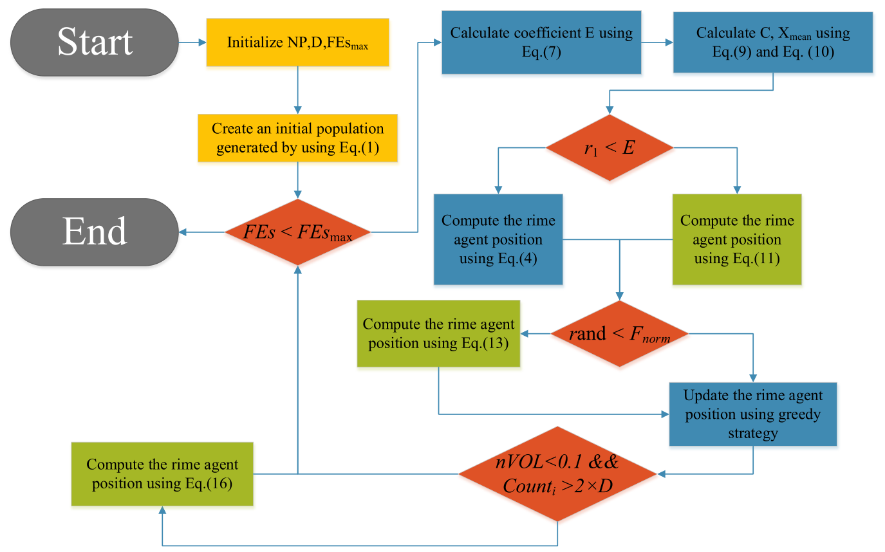
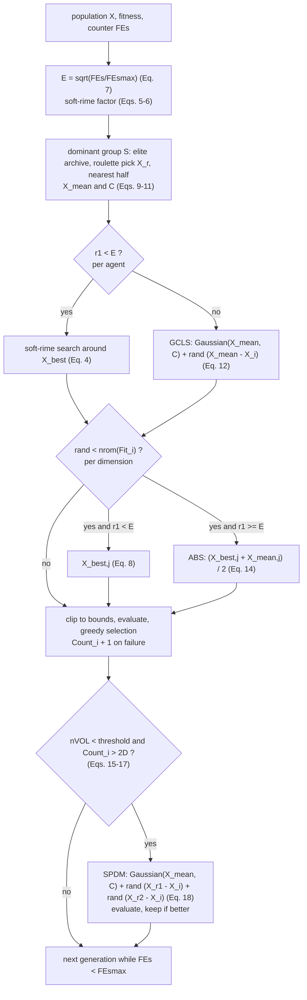
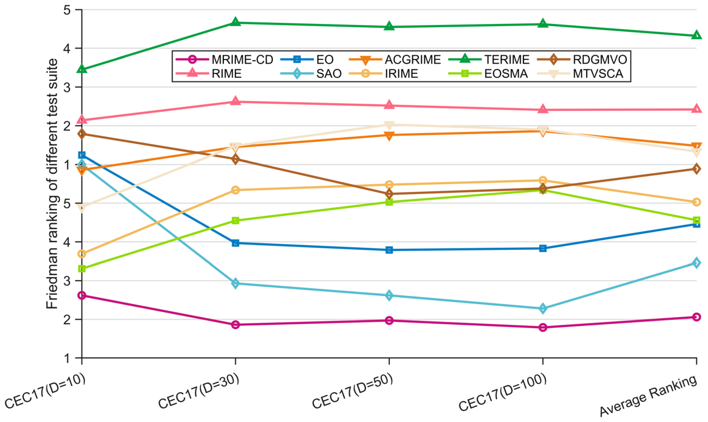
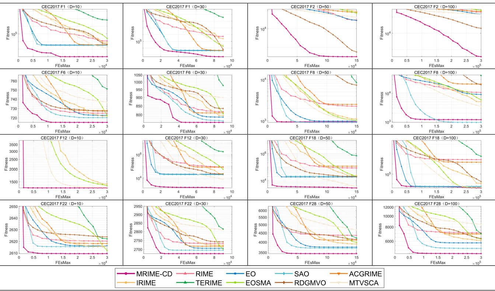
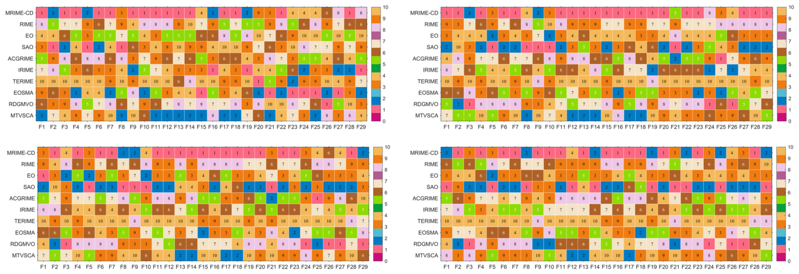
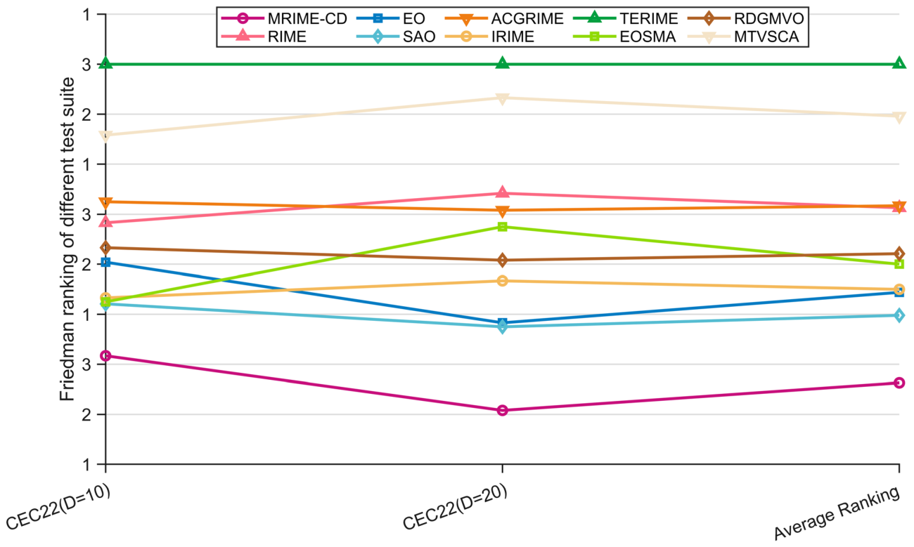
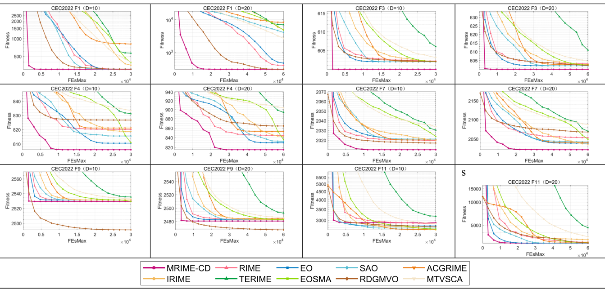

# MRIME-CD: a modified RIME algorithm with covariance learning and diversity enhancement

Official code of the paper *"A modified RIME algorithm with covariance learning and diversity
enhancement for numerical optimization"* (Cluster Computing, 2025): the authors' MATLAB
experiment code and a tested Python reference implementation of RIME, MRIME-CD and its ablation
variants.

[](https://doi.org/10.1007/s10586-025-05348-3)
[](pyproject.toml)
[](LICENSE)
[](https://github.com/OdurShi/mrime/actions/workflows/ci.yml)
[](https://github.com/astral-sh/ruff)

## Overview

RIME is a population-based optimiser that moves every agent towards the best agent found so
far: a *soft-rime search* perturbs single coordinates around the best position, and a *hard-rime
puncture* copies coordinates of the best position. It converges quickly but loses diversity.
MRIME-CD adds three strategies:

* **GCLS** (Gaussian-based covariance learning strategy): early in the run, an agent is replaced
  by a sample from a Gaussian fitted to a *dominant group* of good solutions, plus a pull
  towards the group mean. The share of agents doing this decays as `1 - sqrt(FEs/FEsmax)`.
* **ABS** (average bootstrapping strategy): the puncture uses the midpoint between the best
  agent and the dominant-group mean instead of the best agent alone, for the same early agents.
* **SPDM** (stochastic covariance learning-based population diversity mechanism): when the
  population has collapsed (small normalised volume), agents that keep failing are re-sampled
  from the same Gaussian plus two random difference vectors.

<p align="center">
  
  <br>
  <em>The flowchart of the proposed MRIME-CD algorithm (Fig. 2 of the paper).</em>
</p>

The repository contains

* `matlab/`: the authors' MATLAB experiment code, the competitor algorithms and the CEC2017 /
  CEC2022 benchmark sources and data;
* `src/mrime/`: a NumPy implementation of RIME, MRIME-CD and the six ablation variants of the
  paper (Table 5) behind one small interface (objective, bounds, population size, evaluation
  budget, seed), with an experiment runner, the statistical tests of the paper and plotting;
* `assets/paper_figures/`: the figures of the paper; `data/`: documentation of the benchmark
  data; `docs/implementation_notes.md`: the paper-to-code map and all implementation details.

<details>
<summary>One generation, step by step, as implemented in <code>src/mrime/core.py</code></summary>



</details>

## Installation

Python 3.10 or newer. With [uv](https://docs.astral.sh/uv/):

```bash
git clone https://github.com/OdurShi/mrime.git && cd mrime
uv venv --python 3.11 .venv
uv pip install -p .venv/bin/python -e ".[dev]"
```

With pip:

```bash
python -m venv .venv && source .venv/bin/activate
pip install -e ".[dev]"
```

The core package needs only NumPy, SciPy and PyYAML. The CEC2017 / CEC2022 benchmarks are
compiled on first use from the reference C sources in `matlab/`, which needs a C++ compiler on
the `PATH` (`c++`, `g++` or `clang++`, or set `CXX`). Optional extras: `plot` (matplotlib),
`cec` (the alternative `opfunu` benchmark backend), `figures` (PyMuPDF, for
`scripts/extract_paper_figures.py`).

## Quick start

```bash
mrime demo          # or: python -m mrime demo
```

runs RIME and MRIME-CD on four built-in functions with the same evaluation budget (5 seeds
each, a few seconds on a laptop CPU) and prints the median final value:

```text
dim=10  pop_size=70  max_evals=30000  runs=5  (median final value)
function              RIME      MRIME-CD     evals
sphere          1.1813e-01    7.1139e-08     30000
rosenbrock      1.1778e+01    4.7713e+00     30000
ackley          2.4503e-01    3.4924e-04     30000
ellipsoid       2.2270e+04    9.5510e-02     30000
done in 2.4 s
```

From Python:

```python
import numpy as np
from mrime import minimize, mrime_cd

def objective(x: np.ndarray) -> float:          # any function of a 1-D array
    return float(np.sum((x - 3.0) ** 2))

result = mrime_cd(objective, lower=-100, upper=100, dim=10,
                  pop_size=70, max_evals=30_000, seed=0)
print(result.fun, result.n_evals)               # best value, number of evaluations used
print(result.x)                                 # best position
print(result.history_evals, result.history_best)  # convergence history

# base RIME and the ablation variants of the paper (Table 5) by name
minimize(objective, -100, 100, 10, 70, 30_000, seed=0, algorithm="rime")
minimize(objective, -100, 100, 10, 70, 30_000, seed=0, algorithm="rime-ga")
```

Every objective evaluation, including the initial population, counts against `max_evals`, and
a run is deterministic for a given seed. `mrime list` prints the available variants, profiles
and suites; `examples/quickstart.py` is a slightly longer example; `mrime run --config
configs/quick_classical.yaml` is a small complete experiment with tables.

## Data

The experiments use no external dataset: the inputs are the CEC2017 and CEC2022 benchmark
suites, defined by reference C code and data files (shift vectors, rotation matrices, shuffle
indices). Both ship with the repository, so a clone runs without downloads:

| Suite | Code | Data | Files | Size |
|---|---|---|---|---|
| CEC2017 (29 functions used, D = 10/30/50/100) | `matlab/cec17_func.cpp` | `matlab/input_data/` | 329 | 41.9 MB |
| CEC2022 (12 functions, D = 10/20) | `matlab/cec22_func.cpp` | `matlab/input_data22/` | 54 | 0.77 MB |

The Python package reads the same files as the MATLAB code (default location `matlab/`; override
with `--data-dir` or `MRIME_CEC_SOURCE_DIR`). Sources, versions, file layout, licence notes and
SHA-256 checksums are in [data/README.md](data/README.md).

## Reproducing the paper

Protocol of the paper (Table 2): `FEsmax = 3000 x D`, 51 independent runs per function, CEC2017
(29 functions) at D = 10/30/50/100 and CEC2022 (12 functions) at D = 10/20; MRIME-CD is compared
with RIME, EO, SAO, ACGRIME, IRIME, TERIME, EOSMA, RDGMVO and MTVSCA. The paper's experiments
were run in MATLAB R2022a on an AMD R9 9950X (4.3 GHz) with 64 GB RAM under Windows 11
(Table 1).

| Paper item | Command | Config |
|---|---|---|
| Tables 8-9, 17-20, Figs. 5-8, 13-16: CEC2017, ten algorithms | MATLAB: `Run_CEC2017_total_MRIME` | `dim` in line 21 of the script |
| Tables 10-14, Figs. 9-12, 17-18: CEC2022, ten algorithms | MATLAB: `Run_CEC2022_total_MRIME` | `dim` in line 21 of the script |
| Tables 6-7, Figs. 3-4: ablation of GCLS / ABS / SPDM | MATLAB: `Run_CEC2017_Strategy_MRIME`, `Run_CEC2022_Strategy_MRIME` | `dim` in line 21 of the scripts |
| CEC2017, MRIME-CD and RIME (protocol of Tables 17-20) | `mrime run --config configs/paper/cec2017_comparison.yaml --dim 10` (30, 50, 100) | `configs/paper/cec2017_comparison.yaml` |
| CEC2022, MRIME-CD and RIME (protocol of Tables 10-11) | `mrime run --config configs/paper/cec2022_comparison.yaml --dim 10` (20) | `configs/paper/cec2022_comparison.yaml` |
| Ablation variants of Table 5 (protocol of Tables 6-7) | `mrime run --config configs/paper/cec2017_ablation.yaml --dim 10`, `mrime run --config configs/paper/cec2022_ablation.yaml --dim 10` | `configs/paper/*_ablation.yaml` |
| Wilcoxon rank-sum, Friedman and Kruskal-Wallis tests, mean/std tables | `mrime analyze <results dir> --baseline rime` | - |
| Convergence curves, box plots, Friedman rank chart | `mrime plot <results dir>` | - |
| All Python experiments above, all dimensions | `bash scripts/reproduce_paper.sh` | `configs/paper/` |
| Reduced-scale configurations (D = 10/20) | `bash scripts/reproduce_reduced.sh` | `configs/reduced/` |

Every `mrime run` writes `runs.csv` (one row per run), `curves.csv.gz` (per-run convergence
curves), `meta.json` (resolved protocol, versions, timing) and the tables of `mrime analyze`
into its output directory. The paper does not state the population size; the configs take it
from the MATLAB run scripts (`ceil(15 D^(2/3))` for the CEC2017 comparison, `ceil(30 D^(2/3))`
otherwise).

### MATLAB code

```matlab
cd matlab
mex -setup C++
mex cec17_func.cpp          % the source header suggests: mex cec17_func.cpp -DWINDOWS
mex cec22_func.cpp
Run_CEC2017_total_MRIME     % MRIME-CD, RIME and the eight competitors on CEC2017
Run_CEC2022_total_MRIME     % the same on CEC2022
Run_CEC2017_Strategy_MRIME  % ablation variants of Table 5
Run_CEC2022_Strategy_MRIME
```

* File map: `MRIME_RL_Cov.m` is MRIME-CD, `RIME.m` the base algorithm, and
  `MRIME_RL_1/2/3/12/13/23.m` are the variants RIME-G/A/S/GA/GS/AS.
* Toolboxes: Statistics and Machine Learning (`pdist2`, `ranksum`, `kruskalwallis`,
  `friedman`), Deep Learning (`normr`), Parallel Computing (`parfor`).
* The scripts were written on Windows (`'input_data\Rand_Seeds.txt'`, `<malloc.h>` in the MEX
  sources); adjust the path separator and the include on macOS / Linux. Add a `save` call at
  the end of a run script to keep its results for `Statistics_*.m` and the figure scripts
  `A_Fiugre*.m` (these use the colour-map function `slanCL`).

Competitor implementations used by the run scripts (full list of third-party files in
[THIRD_PARTY_NOTICES.md](THIRD_PARTY_NOTICES.md)):

| File | Algorithm | Attribution stated in the file header | Licence stated |
|---|---|---|---|
| `RIME.m` | RIME | none (base algorithm of Su et al., 2023) | none |
| `EO.m` | Equilibrium Optimizer | none | none |
| `SAO.m` | Snow Ablation Optimizer | L. Deng, S. Liu, DOI 10.1016/j.eswa.2023.120069 | none |
| `ACGRIME.m` | ACGRIME | none | none |
| `IRIME.m` | IRIME | none | none |
| `TERIME.m` | TERIME | none | none |
| `EOSMA.m` | EOSMA | S. Yin, Q. Luo, Y. Zhou, Arab. J. Sci. Eng. (2022) | none |
| `RDGMVO.m` | RDGMVO | none; upstream README in `docs/third-party/` | none |
| `MTVSCA.m` | MTV-SCA | M. H. Nadimi-Shahraki et al. | none |
| `cec17_func.cpp`, `cec22_func.cpp`, `input_data*/` | CEC2017 / CEC2022 suites | CEC competition code (CEC2017: N. Awad) | none |

The Python package follows the equations as printed in the paper. Differences between the
archived MATLAB code and the printed equations, and the options that select either behaviour,
are documented in [docs/implementation_notes.md](docs/implementation_notes.md).

## Method-to-code map

| Paper | Code |
|---|---|
| Eq. (1) initial population | `src/mrime/core.py:run` |
| Eq. (4) soft-rime search | `src/mrime/operators.py:soft_rime_positions` |
| Eqs. (5)-(6) `theta`, `beta` | `operators.py:soft_rime_angle`, `soft_rime_step`, `rime_factor` |
| Eq. (7) `E` | `operators.py:exploration_probability` |
| Eq. (8) hard-rime puncture | `operators.py:normalize_fitness`, `hard_rime_mask` |
| Sect. 3.1 roulette domain selection, FIFO dominant population | `operators.py:rfdb_select`, `DominantArchive`, `select_dominant_group` |
| Eqs. (9)-(11) `X_mean`, weights, `C` | `operators.py:weighted_mean`, `rank_weights`, `covariance`, `fit_gaussian_model` |
| Eq. (12) GCLS, Eq. (13) switch | `operators.py:gcls_candidates`, `core.py:run` |
| Eq. (14) ABS | `operators.py:abs_puncture` |
| Eqs. (15)-(17) `nVOL` | `operators.py:normalized_volume` |
| Eq. (18) SPDM | `operators.py:spdm_candidates` |
| Algorithm 1 / Fig. 2 | `core.py:run` (`core.py:mrime_cd`, `core.py:rime`) |
| Table 2 parameters, Table 5 variants | `src/mrime/config.py` (`MRIMEConfig`, `VARIANTS`, profiles) |
| Tables 3-4 benchmark suites | `src/mrime/benchmarks/cec.py`, `native.py` |
| Tables 6-14 statistics | `src/mrime/analysis.py` |
| Convergence and box-plot figures | `src/mrime/plotting.py` |

The complete map, the unspecified details and the choices made for them are in
[docs/implementation_notes.md](docs/implementation_notes.md).

## Results

All figures and tables in this section are results from the paper (MATLAB experiments, 51
independent runs, `FEsmax = 3000 x D`); the figures are in
[assets/paper_figures/](assets/paper_figures/README.md).

**CEC2017, ten algorithms.** Results from the paper (Fig. 8 and Table 9): Friedman mean rank,
smaller is better.

<p align="center">
  
</p>

| Algorithm | D = 10 | D = 30 | D = 50 | D = 100 | Average ranking |
|---|---|---|---|---|---|
| MRIME-CD | 2.62 | 1.86 | 1.97 | 1.79 | 2.06 |
| RIME | 7.14 | 7.62 | 7.52 | 7.41 | 7.42 |
| EO | 6.24 | 3.97 | 3.79 | 3.83 | 4.46 |
| SAO | 6.00 | 2.93 | 2.62 | 2.28 | 3.46 |
| ACGRIME | 5.86 | 6.45 | 6.76 | 6.86 | 6.48 |
| IRIME | 3.69 | 5.34 | 5.48 | 5.59 | 5.03 |
| TERIME | 8.45 | 9.66 | 9.55 | 9.62 | 9.32 |
| EOSMA | 3.31 | 4.55 | 5.03 | 5.34 | 4.56 |
| RDGMVO | 6.79 | 6.14 | 5.24 | 5.38 | 5.89 |
| MTVSCA | 4.90 | 6.48 | 7.03 | 6.90 | 6.33 |
| P-value | 5.96E-17 | 1.32E-27 | 1.98E-28 | 2.04E-30 | N/A |

Results from the paper (Table 8): Wilcoxon rank-sum test at the 5 % level on CEC2017, numbers
of functions on which MRIME-CD is better / similar / worse (w/e/l).

| MRIME-CD vs. | D = 10 | D = 30 | D = 50 | D = 100 |
|---|---|---|---|---|
| RIME | 26/2/1 | 28/1/0 | 28/1/0 | 29/0/0 |
| EO | 24/5/0 | 23/3/3 | 21/4/4 | 22/4/3 |
| SAO | 22/4/3 | 20/4/5 | 16/5/8 | 13/7/9 |
| ACGRIME | 23/3/3 | 27/2/0 | 27/1/1 | 29/0/0 |
| IRIME | 18/8/3 | 27/1/1 | 25/4/0 | 28/1/0 |
| TERIME | 25/1/3 | 29/0/0 | 29/0/0 | 29/0/0 |
| EOSMA | 19/3/7 | 25/3/1 | 27/2/0 | 28/1/0 |
| RDGMVO | 25/2/2 | 25/1/3 | 19/4/6 | 21/4/4 |
| MTVSCA | 21/3/5 | 26/1/2 | 29/0/0 | 28/0/1 |

Results from the paper (Fig. 6): convergence curves on selected CEC2017 functions (all
functions: Figs. 13-16, `assets/paper_figures/fig13.png` to `fig16.png`).

<p align="center">
  
</p>

Results from the paper (Fig. 5): rank of each algorithm on each CEC2017 function, based on mean
values, for D = 10, 30, 50 and 100.

<p align="center">
  
</p>

**CEC2022, ten algorithms.** Results from the paper (Fig. 12 and Table 14): Friedman mean rank.

<p align="center">
  
</p>

| Algorithm | D = 10 | D = 20 | Average ranking |
|---|---|---|---|
| MRIME-CD | 3.17 | 2.08 | 2.63 |
| RIME | 5.83 | 6.42 | 6.13 |
| EO | 5.04 | 3.83 | 4.44 |
| SAO | 4.21 | 3.75 | 3.98 |
| ACGRIME | 6.25 | 6.08 | 6.17 |
| IRIME | 4.33 | 4.67 | 4.50 |
| TERIME | 9.00 | 9.00 | 9.00 |
| EOSMA | 4.25 | 5.75 | 5.00 |
| RDGMVO | 5.33 | 5.08 | 5.21 |
| MTVSCA | 7.58 | 8.33 | 7.96 |
| P-value | 3.86E-05 | 4.08E-08 | N/A |

Results from the paper (Fig. 9): convergence curves on selected CEC2022 functions (all
functions: Figs. 17-18).

<p align="center">
  
</p>

Results from the paper (Tables 10 and 11, MRIME-CD and RIME columns): mean (standard deviation)
of the final objective value on CEC2022.

| Function | D = 10: RIME | D = 10: MRIME-CD | D = 20: RIME | D = 20: MRIME-CD |
|---|---|---|---|---|
| F1 | 3.0095E+02 (6.94E-01) | 3.0000E+02 (1.40E-08) | 3.9913E+02 (4.72E+01) | 3.0000E+02 (1.40E-07) |
| F2 | 4.1211E+02 (2.20E+01) | 4.0354E+02 (3.73E+00) | 4.5231E+02 (1.44E+01) | 4.4095E+02 (1.88E+01) |
| F3 | 6.0022E+02 (9.62E-02) | 6.0000E+02 (1.58E-05) | 6.0117E+02 (6.75E-01) | 6.0000E+02 (1.96E-04) |
| F4 | 8.1822E+02 (8.64E+00) | 8.0607E+02 (2.20E+00) | 8.4283E+02 (1.54E+01) | 8.1544E+02 (5.12E+00) |
| F5 | 9.0036E+02 (4.46E-01) | 9.0001E+02 (2.43E-02) | 9.2067E+02 (2.74E+01) | 9.0028E+02 (4.24E-01) |
| F6 | 3.9654E+03 (2.02E+03) | 1.8010E+03 (6.78E-01) | 1.2959E+04 (8.67E+03) | 1.8149E+03 (1.94E+01) |
| F7 | 2.0177E+03 (7.59E+00) | 2.0103E+03 (1.00E+01) | 2.0517E+03 (1.57E+01) | 2.0227E+03 (3.49E+00) |
| F8 | 2.2159E+03 (8.85E+00) | 2.2055E+03 (8.73E+00) | 2.2279E+03 (4.45E+00) | 2.2211E+03 (4.94E-01) |
| F9 | 2.5293E+03 (3.91E-03) | 2.5293E+03 (1.01E-10) | 2.4811E+03 (2.57E-01) | 2.4808E+03 (7.81E-09) |
| F10 | 2.5079E+03 (3.04E+01) | 2.5252E+03 (4.56E+01) | 2.5521E+03 (1.23E+02) | 2.5104E+03 (4.86E+01) |
| F11 | 2.8640E+03 (1.17E+02) | 2.8967E+03 (4.27E+01) | 2.9999E+03 (2.48E+01) | 2.9005E+03 (3.39E+00) |
| F12 | 2.8639E+03 (1.58E+00) | 2.8634E+03 (1.99E+00) | 2.9483E+03 (7.42E+00) | 2.9460E+03 (1.06E+01) |

**Ablation of the three strategies.** Results from the paper (Table 6): Friedman mean rank of
RIME, the six variants of Table 5 and MRIME-CD.

| Test suite | D | RIME | RIME-G | RIME-A | RIME-S | RIME-GA | RIME-GS | RIME-AS | MRIME-CD | P-value |
|---|---|---|---|---|---|---|---|---|---|---|
| CEC2017 | 10 | 6.97 | 4.79 | 5.45 | 5.38 | 3.86 | 3.66 | 3.90 | 2.00 | 1.27E-13 |
| CEC2017 | 30 | 7.66 | 2.97 | 6.07 | 6.86 | 2.83 | 2.90 | 4.97 | 1.76 | 1.42E-31 |
| CEC2017 | 50 | 7.55 | 3.14 | 5.76 | 6.83 | 2.83 | 3.66 | 4.97 | 1.28 | 2.14E-30 |
| CEC2017 | 100 | 7.55 | 3.14 | 5.41 | 7.24 | 2.55 | 3.93 | 5.17 | 1.00 | 1.62E-34 |
| CEC2022 | 10 | 6.92 | 4.00 | 5.92 | 5.17 | 4.17 | 3.25 | 4.25 | 2.33 | 9.72E-05 |
| CEC2022 | 20 | 7.50 | 3.67 | 6.08 | 6.08 | 3.00 | 2.92 | 5.08 | 1.67 | 1.10E-09 |

Results from the paper (Table 7): Wilcoxon rank-sum test of each variant against RIME (w/e/l).

| Test suite | D | RIME-G | RIME-A | RIME-S | RIME-GA | RIME-GS | RIME-AS | MRIME-CD |
|---|---|---|---|---|---|---|---|---|
| CEC2017 | 10 | 21/5/3 | 8/21/0 | 16/13/0 | 22/4/3 | 21/5/3 | 22/6/1 | 25/3/1 |
| CEC2017 | 30 | 27/2/0 | 14/15/0 | 13/16/0 | 28/1/0 | 27/2/0 | 24/5/0 | 27/2/0 |
| CEC2017 | 50 | 27/2/0 | 17/12/0 | 7/22/0 | 26/3/0 | 26/2/1 | 23/6/0 | 28/1/0 |
| CEC2017 | 100 | 27/2/0 | 21/8/0 | 2/27/0 | 27/2/0 | 26/3/0 | 22/7/0 | 29/0/0 |
| CEC2022 | 10 | 9/1/2 | 4/7/1 | 5/7/0 | 9/2/1 | 9/1/2 | 9/3/0 | 8/2/2 |
| CEC2022 | 20 | 10/1/1 | 6/5/1 | 8/4/0 | 11/1/0 | 11/1/0 | 10/2/0 | 12/0/0 |

Example outputs of the Python package for the reduced-scale configurations (`configs/reduced/`:
per-run results, convergence curves, tables and figures) are in
[results/reduced/](results/reduced/README.md).

## Repository structure

```text
.
├── README.md  LICENSE  THIRD_PARTY_NOTICES.md  CITATION.cff  pyproject.toml
├── src/mrime/
│   ├── core.py              RIME / MRIME-CD loop (Algorithm 1) and the named entry points
│   ├── operators.py         equation-level operators (Eqs. 4-18)
│   ├── config.py            MRIMEConfig, Table 5 variants, profiles
│   ├── problem.py           bounds, evaluation counter, OptimizeResult
│   ├── experiment.py        experiment runner (runs.csv, curves.csv.gz, meta.json)
│   ├── analysis.py          mean/std tables, Wilcoxon rank-sum, Friedman, Kruskal-Wallis
│   ├── plotting.py          convergence curves, box plots, Friedman ranks
│   ├── cli.py               the `mrime` command
│   └── benchmarks/          classical functions; CEC2017 / CEC2022 (native and opfunu backends)
├── configs/
│   ├── paper/               one YAML per experiment of the paper
│   ├── reduced/             reduced-scale configurations
│   └── quick_classical.yaml
├── scripts/                 run_experiment.py, make_tables.py, make_figures.py,
│                            summarize_results.py, verify_cec_backends.py, data_checksums.py,
│                            extract_paper_figures.py, reproduce_reduced.sh, reproduce_paper.sh
├── examples/quickstart.py
├── tests/                   pytest suite: operators, optimiser loop, benchmarks, runner, CLI, assets
├── assets/paper_figures/    Figs. 1-18 of the paper
├── data/                    README.md and SHA256SUMS for the benchmark data in matlab/
├── results/reduced/         outputs of the reduced-scale configurations
├── docs/implementation_notes.md    paper-to-code map, implementation details, record of runs
├── docs/third-party/        README of the upstream RDGMVO archive
└── matlab/                  the authors' MATLAB code, competitor algorithms, CEC sources and data
```

## Citation

```bibtex
@article{shi2025mrimecd,
  title   = {A modified RIME algorithm with covariance learning and diversity enhancement for numerical optimization},
  author  = {Shi, Shangqing and Zhang, Luoxiao and Yin, Yuchen and Yang, Xiong and Lee, Hoileong},
  journal = {Cluster Computing},
  volume  = {28},
  number  = {658},
  year    = {2025},
  doi     = {10.1007/s10586-025-05348-3}
}
```

## License

The authors' own code (the Python package and the MRIME-CD MATLAB files) is released under the
[MIT License](LICENSE). Third-party files under `matlab/` (competitor algorithms, CEC benchmark
sources and data, helper functions) keep the notices in their own headers and are listed in
[THIRD_PARTY_NOTICES.md](THIRD_PARTY_NOTICES.md). The figures in `assets/paper_figures/` are
reproduced from the published article; copyright remains with the publisher/authors as stated
there.

## Acknowledgements

* RIME, the base algorithm: H. Su et al., "RIME: A physics-based optimization",
  *Neurocomputing* (2023).
* The CEC2017 and CEC2022 single-objective bound-constrained benchmark suites (reference C code
  and data in `matlab/`, see [data/README.md](data/README.md)).
* The authors of the competitor implementations listed in `THIRD_PARTY_NOTICES.md`.
* NumPy, SciPy, PyYAML, matplotlib, and the optional `opfunu` and PyMuPDF packages.
